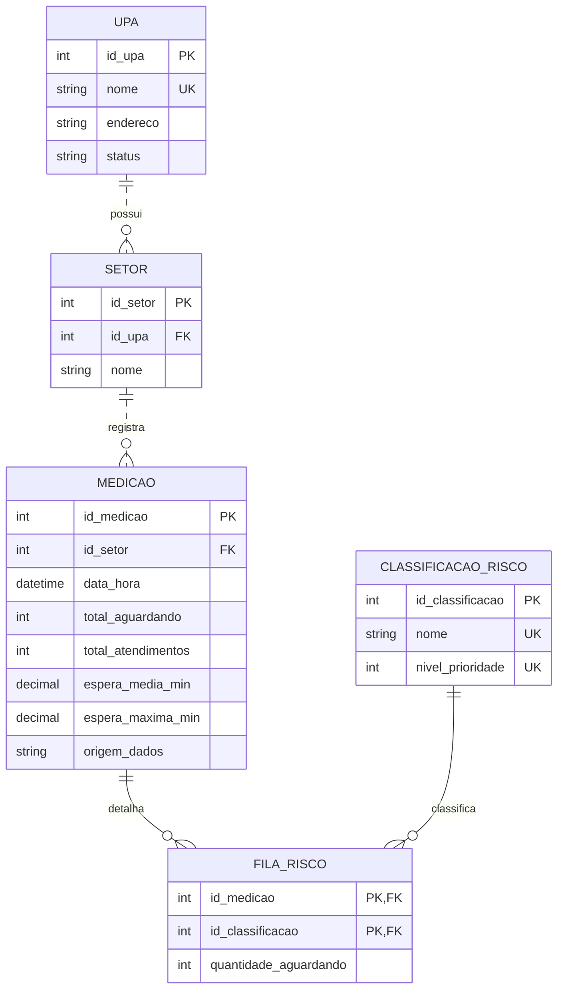

# Sistema UPA Monitor de Porto Velho

## Identificação

**Integrantes:** Vitor Aluizio; Gustavo Nogueira; Maria Clara Nogueira; Vinicius Augusto  
**Disciplina:** Introdução a banco de dados  
**Professor:** Marcos Yerco  
**Data:** 28/10/2026

## 1. Objetivo

Modelar um banco de dados relacional para apoiar o monitoramento de unidades de pronto atendimento, setores, filas, classificações de risco, atendimentos e tempos de espera. O trabalho apresenta um diagrama Entidade-Relacionamento em Mermaid e rotinas estatísticas implementadas e testadas no PostgreSQL por meio do pgAdmin.

## 2. Sistema UPA Monitor

**Sistema consultado:** [UPA Monitor de Porto Velho](https://uptime.portovelho.ro.gov.br/upa-monitor)

O sistema UPA Monitor é a referência temática deste projeto. O modelo de dados apresentado neste trabalho é uma proposta acadêmica baseada nas informações e nos conceitos envolvidos no monitoramento de unidades de pronto atendimento. Não representa uma reprodução confirmada da estrutura interna do banco de dados da Prefeitura.

O ambiente de testes utiliza dados fictícios, identificados no banco pelo campo `origem_dados = 'FICTICIO'`. Esses valores servem para demonstrar o funcionamento das consultas e não devem ser interpretados como indicadores oficiais das unidades de saúde.

## 3. Modelo Entidade-Relacionamento



### 3.1. Entidades e atributos

- **UPA:** representa uma unidade de pronto atendimento. Possui identificador, nome, endereço e status.
- **SETOR:** representa um setor pertencente a uma UPA. Possui identificador, chave estrangeira da unidade e nome.
- **CLASSIFICACAO_RISCO:** armazena as classificações de risco e seus níveis de prioridade.
- **MEDICAO:** registra os indicadores de um setor em determinado instante, incluindo total aguardando, total de atendimentos e tempos de espera.
- **FILA_RISCO:** relaciona uma medição à classificação de risco e informa a quantidade de pessoas aguardando naquela categoria.

### 3.2. Cardinalidades

| Relacionamento | Interpretação |
|---|---|
| `UPA ||..o{ SETOR` | Cada setor pertence a uma UPA; uma UPA pode ter zero ou vários setores. |
| `SETOR ||..o{ MEDICAO` | Cada medição pertence a um setor; um setor pode ter várias medições ao longo do tempo. |
| `MEDICAO ||--o{ FILA_RISCO` | Uma medição pode ter zero ou vários registros de detalhamento por risco. |
| `CLASSIFICACAO_RISCO ||--o{ FILA_RISCO` | Uma classificação pode aparecer em vários registros de fila. |

### 3.3. Chaves e notação

- **PK (Primary Key):** chave primária que identifica cada registro.
- **FK (Foreign Key):** chave estrangeira que relaciona tabelas.
- **UK (Unique Key):** restrição que impede valores duplicados no atributo ou conjunto de atributos.
- **`||`:** exatamente um.
- **`o{`:** zero ou muitos.
- **`..`:** relacionamento não identificador.
- **`--`:** relacionamento identificador.

## 4. Banco de dados e ambiente de testes

O banco foi implementado em **PostgreSQL**, utilizando o **pgAdmin**, no banco `G106` e no schema `public`.

As tabelas criadas foram:

1. `public.upa_monitor_unidade`
2. `public.upa_monitor_setor`
3. `public.upa_monitor_risco`
4. `public.upa_monitor_medicao`
5. `public.upa_monitor_fila_risco`

Os registros de teste utilizam unidades, setores e classificações com identificação de teste. As medições possuem `origem_dados = 'FICTICIO'`.

### Estrutura geral das tabelas

- `upa_monitor_unidade`: cadastro das unidades de pronto atendimento.
- `upa_monitor_setor`: setores vinculados às unidades.
- `upa_monitor_risco`: cadastro das classificações de risco e níveis de prioridade.
- `upa_monitor_medicao`: medições históricas dos indicadores por setor.
- `upa_monitor_fila_risco`: quantidade aguardando por classificação em cada medição.

## 5. Rotina estatística `sp_quadro_de_filas`

A função `public.sp_quadro_de_filas()` apresenta a medição mais recente de cada setor e, quando disponível, o detalhamento da fila por classificação de risco.

Consulta utilizada:

```sql
SELECT * FROM public.sp_quadro_de_filas();
```

O resultado apresenta o nome da UPA, o setor, o horário da medição, a classificação de risco, a quantidade aguardando e a origem dos dados. Quando a classificação e a quantidade aparecem como `NULL`, isso indica que não há detalhamento cadastrado para aquela medição; não significa necessariamente que não existam pessoas aguardando.

Os resultados obtidos durante os testes foram gerados com dados fictícios no PostgreSQL.

## 6. Rotina estatística `sp_atlas_e_cubos`

A função `public.sp_atlas_e_cubos()` apresenta a medição mais recente de cada setor, incluindo o total de atendimentos, o total aguardando e os tempos médio e máximo de espera registrados.

Consulta utilizada:

```sql
SELECT * FROM public.sp_atlas_e_cubos();
```

A função permite consultar os indicadores por unidade e setor. Os tempos de espera e as quantidades utilizados nos testes foram inseridos como exemplos fictícios, não calculados a partir de registros individuais de pacientes.

## 7. Validação dos dados de fila

Foi realizada uma consulta para comparar o total de pessoas aguardando informado na medição com a soma das quantidades detalhadas por classificação de risco.

```sql
SELECT
    m.id_medicao,
    m.total_aguardando,
    SUM(f.quantidade_aguardando) AS fila_detalhada,
    m.total_aguardando - SUM(f.quantidade_aguardando) AS diferenca
FROM public.upa_monitor_medicao m
JOIN public.upa_monitor_fila_risco f
    ON f.id_medicao = m.id_medicao
GROUP BY m.id_medicao, m.total_aguardando
ORDER BY m.id_medicao;
```

Na medição fictícia da Clínica da UPA Leste, as classificações de risco somaram 12 pessoas, enquanto o total aguardando também era 12. A diferença foi zero, demonstrando consistência entre o total e o detalhamento nesse exemplo de teste. Essa validação não representa uma verificação dos dados reais do sistema oficial.

## 8. Uso da inteligência artificial no desenvolvimento

A inteligência artificial foi utilizada como apoio à elaboração do modelo Entidade-Relacionamento, à definição das entidades e de seus relacionamentos, à construção das tabelas e à criação das rotinas de consulta estatística.

Durante o desenvolvimento, as sugestões foram aplicadas e testadas no PostgreSQL por meio do pgAdmin. Os testes permitiram consultar o quadro de filas, visualizar indicadores por setor e comparar o total aguardando com o detalhamento por classificação de risco. O resultado foi analisado considerando a diferença entre dados fictícios de demonstração e dados oficiais.

A implementação exigiu uma adaptação de tecnologia: o enunciado menciona procedures do SQL Server, mas o ambiente utilizado foi PostgreSQL. Por isso, as rotinas implementadas são funções PostgreSQL criadas com `CREATE FUNCTION`, e não procedures do SQL Server.

## 9. Justificativas técnicas

### 9.1. Integridade referencial

As chaves estrangeiras relacionam setores às UPAs, medições aos setores e registros de fila às medições e classificações. Isso ajuda a impedir a criação de registros associados a entidades inexistentes.

### 9.2. Chave composta em `FILA_RISCO`

A chave primária composta `(id_medicao, id_classificacao)` impede que a mesma classificação seja cadastrada mais de uma vez na mesma medição.

### 9.3. Histórico de medições

Cada registro de `MEDICAO` representa uma fotografia dos indicadores em determinado instante. As funções selecionam a medição mais recente de cada setor para apresentar uma visão atual aproximada. A análise histórica exige consultar várias medições e aplicar critérios de agregação adequados.

### 9.4. Contagem de pessoas aguardando

Medições realizadas em horários diferentes não devem ser somadas como se representassem pessoas distintas, pois uma mesma pessoa pode aparecer em várias medições enquanto aguarda atendimento. Para contar pessoas únicas, seriam necessários dados apropriados de atendimentos individuais.

### 9.5. Tempos de espera

Os tempos utilizados nos testes são valores fictícios inseridos para demonstrar o funcionamento das consultas. Para produzir estatísticas oficiais, seria necessário conhecer a definição do indicador, a unidade de tempo, o período de referência e a origem dos dados.

## 10. Conclusão

O trabalho apresentou um modelo relacional acadêmico para representar unidades de pronto atendimento, setores, medições, classificações de risco e quantidades de pessoas aguardando. Foram criadas tabelas relacionadas por chaves primárias e estrangeiras, duas funções estatísticas em PostgreSQL e uma consulta de validação dos dados da fila.

Os testes demonstraram como consultar o quadro de filas, visualizar indicadores por setor e verificar a consistência entre o total aguardando e o detalhamento por classificação de risco. Como os dados utilizados são fictícios, os resultados servem apenas para demonstrar o funcionamento da solução. O modelo também não deve ser interpretado como uma reprodução confirmada da estrutura interna do UPA Monitor da Prefeitura de Porto Velho.

## 11. Referências

- Prefeitura de Porto Velho. **UPA Monitor**. https://uptime.portovelho.ro.gov.br/upa-monitor
- Mermaid. **Entity Relationship Diagrams**. https://mermaid.js.org/syntax/entityRelationshipDiagram.html
- Mermaid. **Mermaid Live Editor**. https://mermaid.live/
- Microsoft Learn. **CREATE PROCEDURE (Transact-SQL)**. https://learn.microsoft.com/pt-br/sql/t-sql/statements/create-procedure-transact-sql
- PostgreSQL Documentation. **CREATE FUNCTION**. https://www.postgresql.org/docs/current/sql-createfunction.html
- PostgreSQL Documentation. **CREATE TABLE**. https://www.postgresql.org/docs/current/sql-createtable.html
